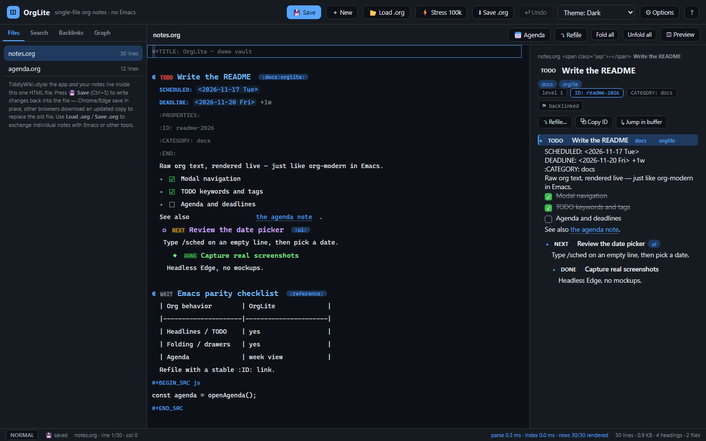
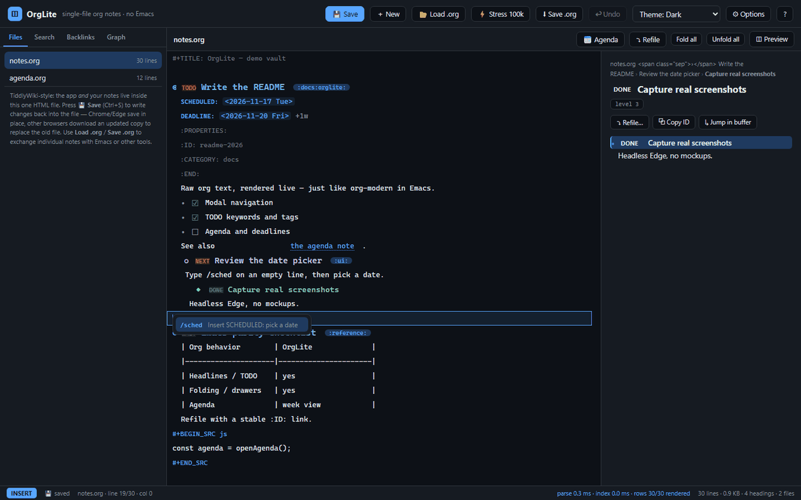
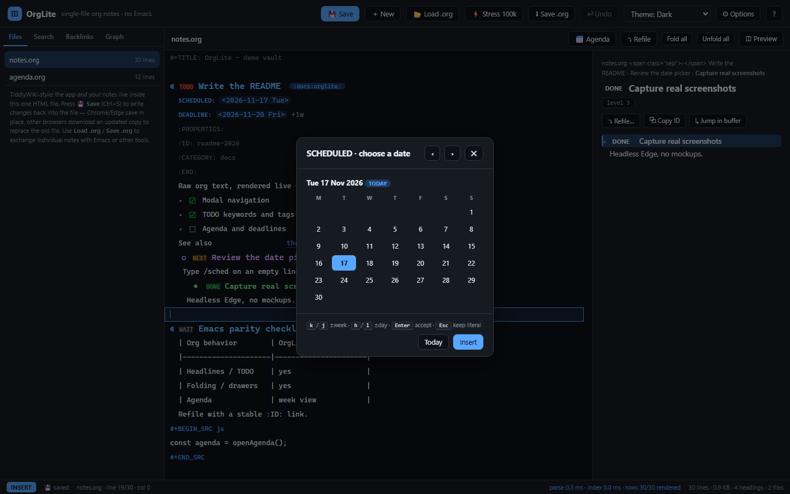
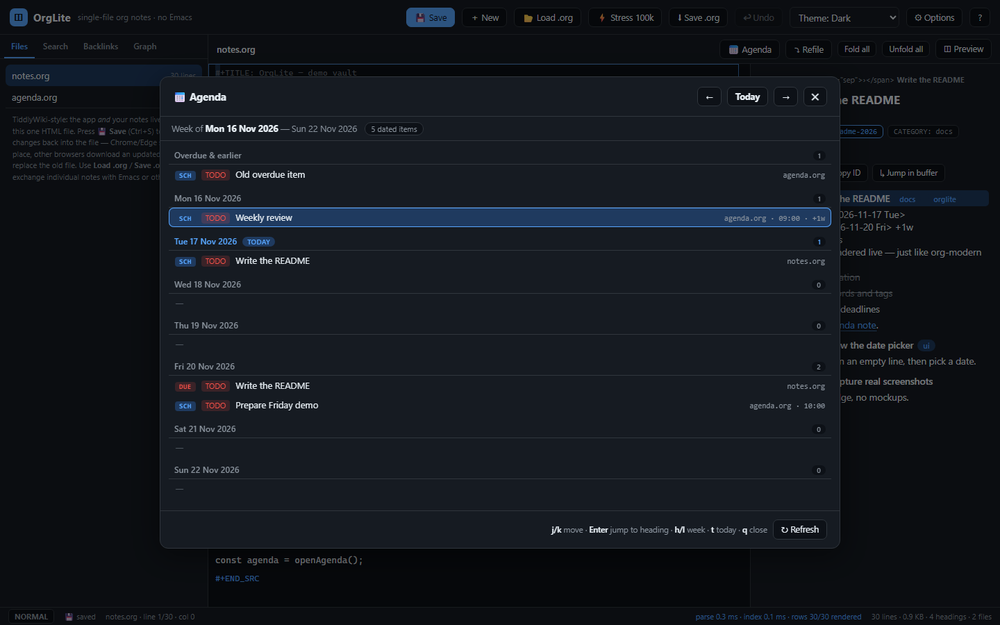
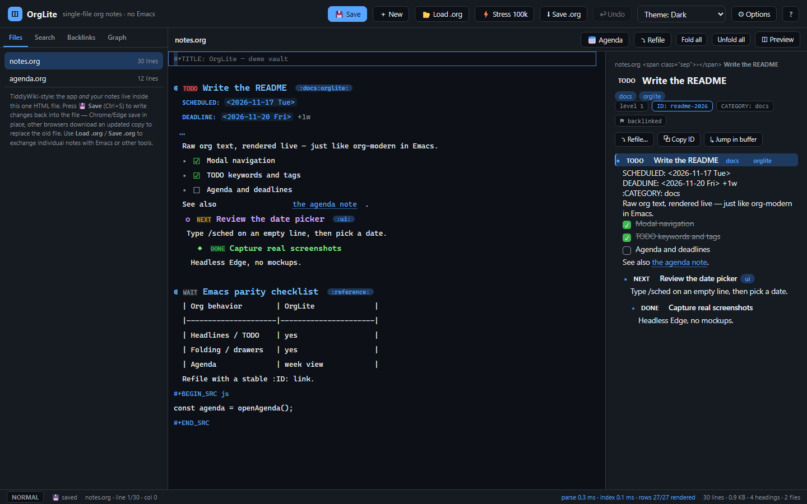
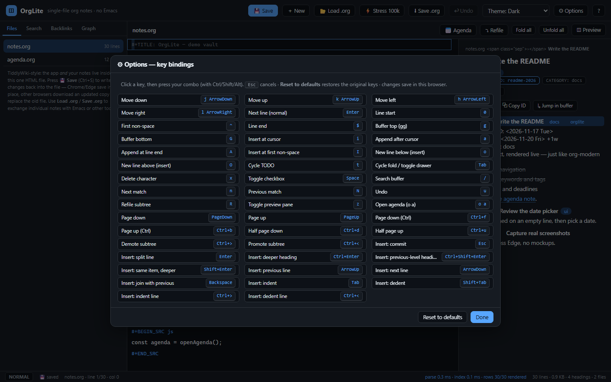

# OrgLite — org-mode habits, one HTML file

**OrgLite is a dependency-free, single-file notebook for people who think in org-mode.**
It keeps the plain-text `.org` file as the source of truth, renders it live like
`org-modern` in Emacs, and gives you Doom/Evil-style modal keys — without Emacs,
packages, a server, or a build step to *use* it.



*The buffer is the editor and the viewer. Raw org text stays underneath; the pretty
view re-renders as you type. Screenshots here are real captures of the app, not
mockups.*

---

## Why you might like it

- **Feels like home if you use Emacs.** Normal/insert modes, `j/k/h/l`, `i`, `a`,
  `o`, `gg`, `G`, `Ctrl-f/b`, fold with `Tab`, cycle TODO with `t`, toggle a
  checkbox with `Space`, refile with `R`.
- **Org syntax is real data, not decoration.** Headlines, TODOs, priorities, tags,
  `:PROPERTIES:` drawers, `[[id:…][desc]]` links, checkboxes, `<timestamps>`,
  `SCHEDULED:`, `DEADLINE:`, lists, and `#+BEGIN_SRC` blocks are parsed from the
  file you edit.
- **An actual agenda.** `o a` opens a week of every scheduled/deadline item across
  all files, with repeaters, overdue items, and click/Enter-to-jump.
- **Portable.** One `orglite.html` holds the app *and* your notes. 💾 Save rewrites
  that file; `Load .org` / `Save .org` exchange individual notes with Emacs.
- **Fast.** The buffer is virtualized; a 100k-line file still navigates
  immediately.

---

## Get started in 60 seconds

1. Open **`orglite.html`** in a browser. There is nothing to install.
2. Move with `j/k` and open a line with `i` or `a`. Press `Esc` to return to
   normal mode.
3. Put the cursor on a heading and press `Tab` to fold it. Press `t` to cycle its
   TODO state. Press `Space` on a `- [ ]` line to check it off.
4. On a blank line in insert mode, type `/sched`, then press **Enter** to accept
   today — or use your navigation keys to pick another date.
5. Press `o a` for the agenda. Click a row (or press Enter) to jump back to the
   heading.
6. Press **💾 Save** or `Ctrl+S` to embed your notes into the HTML file itself.



*The capture → schedule → agenda loop, end to end. All frames are real app states.*

---

## The mental model

OrgLite has three ideas worth knowing:

1. **The raw org file is the source of truth.** Nothing is hidden in a database.
   What you type is what gets saved.
2. **One rendered buffer.** There is no “source vs preview” toggle. Markup is
   styled in place — `**bold**` becomes bold, a heading gets its level color and
   TODO pill, a timestamp gets its chip — but the underlying text is unchanged.
3. **Modal editing.** In `NORMAL` you navigate and command; in `INSERT` you type.
   The status bar always tells you which mode you are in, and the block caret
   sits on the character under the cursor.

Everything in the key tables below is a **default**. Open **⚙ Options** to
rebind any command — including multi-key sequences such as `o a` — then reset
to defaults whenever you want.

---

## Key map (defaults)

### Normal mode

| Keys | Action | org-mode analogue |
|---|---|---|
| `j` / `k` / `h` / `l`, arrows | down / up / left / right | Evil / `C-n C-p C-f C-b` |
| `i` / `a` / `A` / `I` | insert / append / end of line / first non-space | Evil insert commands |
| `o` / `O` | new line below / above, enters insert | `o` / `O` |
| `Esc` | back to normal mode | `Esc` |
| `Enter` | move down | — |
| `0` `^` `$` | line start / first non-space / line end | `0` `^` `$` |
| `gg` / `G` | top / bottom of buffer | `gg` / `G` |
| `Ctrl-f` `Ctrl-b` `Ctrl-d` `Ctrl-u` | page down/up, half down/up | `C-f C-b C-d C-u` |
| `Tab` | cycle fold: open → children-only → folded | `TAB` |
| `S-Tab` | fold all | `S-TAB` |
| `t` | cycle TODO → NEXT → DONE → none | `C-c C-t` |
| `Space` | toggle `- [ ]` / `- [X]` | `C-c C-c` on a checkbox |
| `x` / `u` | delete char / undo | `x` / `u` |
| `/` `n` `N` | search buffer / next / previous match | `C-s` style search |
| `Ctrl+>` / `Ctrl+<` | demote / promote **whole subtree** | `org-metaright` / `org-metaleft` |
| `R` | refile subtree across files | `C-c C-w` |
| `z` | toggle the preview pane | narrow / indirect buffer feel |
| `o a` | open the Agenda | `C-c a` |

> `o a` is a two-key sequence: press `o`, then `a` within 600 ms. A plain `o`
> still creates a new line below, so your normal Vim muscle memory is intact.

### Insert mode

| Keys | Action |
|---|---|
| `Esc` | commit and return to normal mode |
| `Enter` | split at cursor, keeping the same level/item; headings and lists continue sensibly |
| `Shift+Enter` | same item one indent deeper |
| `Ctrl+Enter` | new heading one level deeper |
| `Ctrl+Shift+Enter` | new heading at the previous heading's level |
| `Tab` | insert indentation |
| `Ctrl+>` / `Ctrl+<` | indent / dedent the current line |
| `Backspace` at column 0 | join with previous line |
| `/sched`, `/deadline`, `/due`, `/dl` | open the date picker on a blank line |

Typing edits raw text and only the edited line restyles per keystroke, so
`*bold*` turns bold the moment you close it and a new `:tag:` pill appears
immediately. Backslashes are preserved: paths like `C:\Users\me` and escaped
`\*literal*` stay exactly as typed. A slash in the middle of a line is ordinary
text; slash commands only trigger on an otherwise blank line.

---

## Capture with the date picker

On a blank line in insert mode:

1. Type `/sched` or `/deadline` (aliases: `/schedule`, `/due`, `/dl`).
2. Press **Enter** or **Space**. The date picker opens with **today highlighted**.
3. Press **Enter** immediately for today, or navigate:
   - your `up` / `down` bindings move ±1 week
   - your `left` / `right` bindings move ±1 day
   - with default keys: `k`/`j` = ±week, `h`/`l` = ±day
4. Press **Enter** to insert `SCHEDULED: <2026-11-17 Tue>` or
   `DEADLINE: <…>`, or click a day in the calendar.
5. Press **Esc** to cancel and keep the literal `/cmd` text.



The picker uses **your** bindings from Options. If you rebind `down` to `s`,
then `s` moves the selection down one week; arrow keys only work if they remain
part of those bindings.

---

## Agenda: the org-mode feature you use most

Press `o a` (or click **📅 Agenda**). OrgLite collects every hardcoded
`SCHEDULED:` and `DEADLINE:` line from every open file and shows a Monday–Sunday
week:

- scheduled and deadline items in day groups, with `TODAY` marked
- overdue and later items in their own sections
- repeaters such as `+1d`, `+1w`, `+1m`, `+1y`
- TODO state, priority, file name, and time when present
- click a row or press **Enter** to jump to the exact heading and line

Inside the agenda: `j/k` move, `h/l` change week, `t` returns to today, `r`
refreshes, `q`/`Esc` closes.



Plan lines use the standard org shape:

```org
* TODO Write the README :docs:
  SCHEDULED: <2026-11-17 Tue>
  DEADLINE: <2026-11-20 Fri> +1w
```

---

## Folding, drawers, and narrowing

`Tab` cycles a heading through open → children-only → folded. Folded headings
show a single `…` marker with no hidden-line counter.

A `:PROPERTIES:` drawer folds independently: put the cursor anywhere in the
drawer and press `Tab` to collapse it to `…`; press `Tab` again (or click) to
reopen. `S-Tab` folds everything, including drawers.



The **preview pane** (toggle with `z`) shows the whole subtree under the cursor,
narrowed like an org indirect buffer. Click a subheading to jump; click a
checkbox to toggle it. Drag the divider to resize; the width persists.

---

## Links, backlinks, and refile

OrgLite follows the org-roam model:

- `[[id:20261117-readme][the README task]]` resolves by stable `:ID:`.
- `[[some-title]]` resolves by heading title or slug.
- `[[notes.org]]` resolves to that file's first heading.
- The **Links** sidebar shows linked references and plain-text unlinked mentions.
- The **Graph** tab draws the vault as a node graph.

Press `R` on a heading to refile its subtree into another file. Levels are
re-based onto the destination, `:ID:` values travel with the subtree, and
backlinks keep resolving after the move. `u` undoes a refile and returns you to
the source file.

---

## Make it yours

**⚙ Options** lists every command and its current key. Click a keycap and press
a new key or sequence to rebind it. Defaults are preserved, changes are stored
in `localStorage` under `orglite.keys`, and **Reset** restores everything.



There are also 9 instant CSS-variable themes (dark, light, and several Doom
inspirations), a UTF-8-friendly renderer (日本語, Задача, 任務, Überblick), a
dirty indicator, and an unsaved-changes guard.

---

## Org-mode parity: what matches, what differs

OrgLite aims for **workflow parity**, not feature-for-feature Emacs equivalence.

| Standard org-mode | OrgLite | Notes |
|---|---|---|
| Headline trees, any depth | ✅ | `******` works; no three-level limit |
| TODO/DONE, priorities `[#A]`, tags `:tag:` | ✅ | compact built-in TODO cycle; tags are not inherited |
| Checkboxes `- [ ]` / `- [X]` | ✅ | `Space` toggles |
| Folding and `org-cycle` | ✅ | three-state `Tab` cycle, drawer folding, fold-all |
| `:PROPERTIES:` with `:ID:` | ✅ | `:ID:` drives stable links and refile |
| `[[id:…][desc]]` links | ✅ | plus title, slug, and file-stem targets |
| Backlinks / org-roam graph | ✅ | linked + unlinked mention views |
| `SCHEDULED:` / `DEADLINE:` and agenda | ✅ | hardcoded plan-line parsing; week agenda with repeaters |
| Timestamps `<YYYY-MM-DD Day>` | ✅ | parsed for agenda; simple `+n` repeaters |
| Plain lists, bold/italic/underline/code/verbatim | ✅ | rendered live; raw text preserved |
| `#+BEGIN_SRC` blocks | ◑ | keywords styled; **not executed** (no Babel) |
| Tables | ◑ | plain text stays intact; **no column editor or formulas** |
| Refile `C-c C-w` | ✅ | `R`, with level adjustment and ID preservation |
| `org-todo-keywords` customization | ❌ | fixed TODO → NEXT → DONE → none cycle |
| Custom agenda views / `org-agenda-files` | ❌ | one week view across all loaded files |
| Capture templates, clocking, attachments, export backends, Elisp | ❌ | outside scope of this single-file prototype |

The honest summary: **daily org editing, navigation, refile, links, and a
working agenda are here; the Emacs ecosystem around org is not.**

---

## Saving: the single-file trick

`orglite.html` is a TiddlyWiki-style file:

```text
orglite.html
├── <div id="app-root">          empty shell
├── <script id="orglite-store">  JSON: markup + css + app + your files
└── <script id="boot">           tiny bootstrap
```

- **💾 Save / `Ctrl+S`** rebuilds the store JSON with your current notes and
  rewrites the HTML file. `<`, `>`, and `&` are escaped as `\u003C` etc., so the
  app cannot corrupt itself during an HTML round-trip.
- **Chrome/Edge** can save in place after you pick the file once.
  **Firefox/Safari** download an updated copy — replace the old file, exactly
  like classic TiddlyWiki.
- **Crash recovery:** unsaved changes mirror to browser storage and auto-restore
  on reopen. The status bar shows `💾 saved` or `● unsaved changes`.
- **Interop:** `📂 Load .org` and `⬇ Save .org` move individual files in and out
  of Emacs. No note is hostage to OrgLite.

> Keep the whole vault under a few MB. A 100k-line stress file opens instantly,
> but every save rewrites the whole HTML file. Don't edit two copies in separate
> windows at once.

---

## For contributors

The published app is generated; edit the sources, then rebuild:

```bash
python build.py          # writes orglite.html and validates the store
node smoke.js            # DOM smoke test (navigation, edit, fold, refile, save/reload)
node bench.js            # parse / index / search benchmarks
```

| Path | Role |
|---|---|
| `src/app.js` | parser, renderer, modal editing, agenda, links, refile, persistence |
| `src/app.css` | themes, org-modern styling, modals, virtualized buffer |
| `src/app.markup.html` | app shell, sidebar panels, help/options/agenda modals |
| `build.py` | assembles and validates the single file |
| `tauri/` + `.github/workflows/build-windows.yml` | optional native Windows shell |

Saved copies of `orglite.html` embed the UI they were built with. After editing
`src/*`, generate a fresh `orglite.html` — old saved files will not gain the new
UI automatically.

---

## Quick verdict

OrgLite is for you if you want the *feel* of org-mode — headlines, TODOs,
folding, links, refile, and an agenda — in a file you can email, drop on a USB
stick, or open offline in any browser. It is not a replacement for a configured
Emacs setup with Babel, capture templates, or custom agenda views.

Open `orglite.html`, press `i`, then `o a`. That is the whole pitch.
